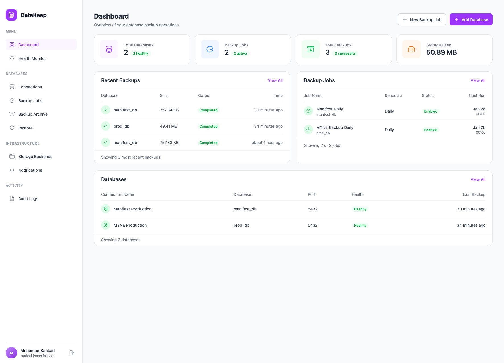

# DataKeep

**Open-source database backup, sync, and monitoring platform for PostgreSQL databases.**

DataKeep provides automated backup scheduling, database syncing, health monitoring, and backup management through an intuitive web interface built with Ruby on Rails.



## Features

### Database Management
- **Multiple Database Connections** - Connect and manage multiple PostgreSQL databases
- **Connection Testing** - Verify database connectivity before saving configurations
- **Database URL Parsing** - Automatically parse connection strings for quick setup
- **Secure Credentials** - Encrypted storage for database passwords
- **VPN Support** - Connect to databases behind OpenVPN or IPSec tunnels

### Backup Management
- **Scheduled Backups** - Daily, weekly, monthly, or custom cron schedules
- **Manual Backups** - Trigger backups on-demand
- **Backup History** - View and manage all backup records
- **File Deletion** - Delete backup files from storage when removing records
- **Retention Policies** - Automatic cleanup based on retention days
- **Restore** - Restore backups to any connected database

### Database Sync
- **One-to-Many Replication** - Sync one source database to multiple targets
- **Interval Scheduling** - Configurable sync intervals
- **Execution History** - Track sync job runs and status

### Storage Backends
- **Local Storage** - Store backups on the local filesystem
- **AWS S3** - Cloud storage with configurable bucket and prefix
- **Multiple Backends** - A single backup job can write to multiple storage backends
- **Managed Backends** - Admin-created system-wide storage (S3 buckets shared across tenants)

### Health Monitoring
- **Automated Health Checks** - Regular connectivity and performance checks
- **Health Heatmap** - Visual 24-hour health status overview
- **Uptime Tracking** - Monitor database availability percentage
- **Alert System** - Notifications via Slack, Discord, Telegram, Webhook, or Email

### Enterprise Billing
- **SaaS Plans** - Free and enterprise tiers with configurable limits
- **Stripe Integration** - Subscription billing with invoice management
- **Enterprise Quotes** - Custom pricing calculator for large deployments
- **Admin Panel** - User management, pricing config, audit logs

## Tech Stack

- **Framework**: Ruby on Rails 8.1
- **Database**: PostgreSQL 16
- **Background Jobs**: Sidekiq 8 + sidekiq-cron (Redis-backed)
- **Frontend**: Hotwire (Turbo + Stimulus), Tailwind CSS, TailAdmin
- **Billing**: Stripe
- **Auth**: Custom session-based with bcrypt
- **Deployment**: Docker + AWS ECS (Fargate Spot + EC2)

## Requirements

- Docker & Docker Compose (recommended for development)
- Or: Ruby 3.4.7+, PostgreSQL 16+, Redis 7.0+

---

## Local Development

### Quick Start with Docker

```bash
# Clone and start
git clone https://github.com/Kaakati/datakeep.git
cd datakeep
docker compose up

# Setup database (first run)
docker compose exec web bin/rails db:create db:migrate db:seed

# Visit http://localhost:3000
```

Services started by Docker Compose:
- **web** - Rails app on [http://localhost:3000](http://localhost:3000)
- **jobs** - Sidekiq worker (with VPN capabilities: NET_ADMIN, /dev/net/tun)
- **db** - PostgreSQL on port 5430 (host)
- **redis** - Redis on port 6370 (host)

### Docker Commands

```bash
docker compose up -d              # Start in background
docker compose logs -f web        # Tail web logs
docker compose exec web bin/rails console  # Rails console
docker compose exec web bundle exec rspec  # Run tests
docker compose down               # Stop all services
```

### Manual Installation (without Docker)

<details>
<summary>Click to expand</summary>

```bash
bundle install
bin/rails db:create db:migrate
redis-server                  # Terminal 1
bin/rails server              # Terminal 2
bundle exec sidekiq           # Terminal 3
```

</details>

### Environment Variables

Copy `.env.example` to `.env` (loaded by `dotenv-rails`):

| Variable | Description | Default |
|----------|-------------|---------|
| `DATABASE_URL` | PostgreSQL connection URL | - |
| `REDIS_URL` | Redis connection URL | `redis://localhost:6379/0` |
| `SECRET_KEY_BASE` | Rails secret key (required in production) | - |
| `RAILS_MASTER_KEY` | Decrypts Rails credentials | - |
| `STRIPE_SECRET_KEY` | Stripe API key | - |
| `STRIPE_WEBHOOK_SECRET` | Stripe webhook signing secret | - |

### Running Tests

```bash
bundle exec rspec                          # Full suite
bundle exec rspec spec/models/             # Model specs only
bundle exec rspec spec/models/user_spec.rb # Single file
bundle exec rubocop                        # Linting
bundle exec brakeman                       # Security scan
```

---

## Production Deployment (AWS ECS)

DataKeep runs on AWS ECS in **eu-south-1 (Milan)** using the `manifest` AWS profile. The infrastructure is managed with Terraform/OpenTofu.

### Architecture

```
Internet
   │
   ▼
┌──────────────────────────────────────────────────┐
│  ALB (HTTPS with ACM certificate)                │
│  datakeep-production-alb                         │
│  Public subnets (2 AZs)                          │
└──────────────┬───────────────────────────────────┘
               │ port 8080
               ▼
┌──────────────────────────────────────────────────┐
│  ECS Cluster: datakeep-production                │
│                                                  │
│  ┌─────────────────┐  ┌──────────────────────┐   │
│  │ Web Service      │  │ Jobs Service          │  │
│  │ Fargate Spot     │  │ EC2 (t3.small)        │  │
│  │ 1 vCPU / 2 GB   │  │ NET_ADMIN + /dev/tun  │  │
│  │ Puma + Thruster  │  │ Sidekiq               │  │
│  │ Public subnet    │  │ Public subnet         │  │
│  └─────────────────┘  └──────────────────────┘   │
│                                                  │
│  ┌─────────────────────────────────────────────┐ │
│  │ Private subnets                              │ │
│  │ ┌─────────┐ ┌──────────┐ ┌───────────────┐  │ │
│  │ │ RDS     │ │ Redis    │ │ EFS           │  │ │
│  │ │ PG 16   │ │ 7.1      │ │ /storage      │  │ │
│  │ │ t3.micro│ │ t3.micro │ │ /backups      │  │ │
│  │ └─────────┘ └──────────┘ └───────────────┘  │ │
│  └─────────────────────────────────────────────┘ │
└──────────────────────────────────────────────────┘
```

**Key design decisions:**
- **Web on Fargate Spot** - 70% cost savings, ALB handles failover
- **Jobs on EC2** - Fargate doesn't support `NET_ADMIN`/`NET_RAW` capabilities needed for VPN tunneling
- **Public subnets for ECS** - Free public IPs on Fargate ENIs eliminate NAT costs entirely
- **Private subnets for data** - RDS, Redis, and EFS are not internet-accessible

### Cost Breakdown (~$112/mo)

| Component | Monthly |
|---|---:|
| ALB | ~$27 |
| ECS Web (1x Fargate Spot, 1 vCPU/2 GB) | ~$14 |
| ECS Jobs (1x t3.small EC2) | ~$17 |
| RDS (db.t3.micro, 20 GB gp3) | ~$17 |
| ElastiCache (cache.t3.micro) | ~$14 |
| EFS (~10 GB) | ~$5 |
| Secrets Manager (6 secrets) | ~$3 |
| CloudWatch Logs | ~$10 |
| ECR + Data Transfer | ~$5 |
| **Total** | **~$112** |

### Infrastructure Files

```
infra/
├── Makefile                    # Common operations
├── terraform/
│   ├── main.tf                 # Provider (manifest profile, eu-south-1)
│   ├── variables.tf            # Input variables with lean defaults
│   ├── outputs.tf              # ALB DNS, ECR URL, endpoints
│   ├── vpc.tf                  # VPC, 2 public + 2 private subnets
│   ├── security_groups.tf      # ALB, ECS, RDS, Redis, EFS SGs
│   ├── alb.tf                  # ALB, target group, HTTPS listener
│   ├── ecr.tf                  # ECR repository + lifecycle policy
│   ├── ecs_cluster.tf          # Cluster + FARGATE_SPOT + EC2 providers
│   ├── ecs_iam.tf              # Execution role, task role, EC2 role
│   ├── ecs_web.tf              # Web task def + Fargate Spot service
│   ├── ecs_jobs.tf             # Jobs task def + EC2 service + ASG
│   ├── ecs_migrate.tf          # One-off migration task definition
│   ├── rds.tf                  # PostgreSQL 16, db.t3.micro
│   ├── elasticache.tf          # Redis 7.1, cache.t3.micro
│   ├── efs.tf                  # Encrypted EFS + access points
│   ├── secrets.tf              # 6 Secrets Manager entries
│   ├── cloudwatch.tf           # Log groups (web, jobs, migrate)
│   ├── autoscaling.tf          # Web auto-scaling (1-2 tasks)
│   └── terraform.tfvars.example
└── scripts/
    ├── deploy.sh               # Build, push, migrate, deploy
    ├── migrate.sh              # Run migrations as one-off task
    └── rollback.sh             # Rollback to previous task definition
```

### Prerequisites

- [OpenTofu](https://opentofu.org/) or Terraform >= 1.5
- AWS CLI configured with `manifest` profile (`aws configure --profile manifest`)
- Docker (for building images)
- Domain DNS managed in Cloudflare (or any DNS provider)

### First-Time Setup

#### 1. Request an ACM certificate

```bash
cd infra
make cert
```

Add the CNAME validation record in Cloudflare. Wait for the certificate status to become `ISSUED`:

```bash
aws acm describe-certificate \
  --certificate-arn <ARN> \
  --profile manifest --region eu-south-1 \
  --query 'Certificate.Status'
```

#### 2. Configure Terraform variables

```bash
cp terraform/terraform.tfvars.example terraform/terraform.tfvars
# Edit terraform.tfvars — set certificate_arn to the issued cert ARN
```

#### 3. Create infrastructure

```bash
make init    # Initialize providers
make plan    # Review resources (86 resources)
make apply   # Create everything (~7 minutes)
```

#### 4. Set secrets

```bash
# Rails master key
make set-master-key

# Stripe keys (when ready)
make set-stripe-keys STRIPE_KEY=sk_live_... STRIPE_WEBHOOK=whsec_...
```

#### 5. Build and deploy

```bash
make ecr-login                 # Authenticate Docker to ECR
make deploy TAG=v1             # Build, push, migrate, deploy
```

#### 6. Seed the database (optional)

```bash
# Run db:seed as a one-off Fargate task
SUBNETS=$(aws ec2 describe-subnets --profile manifest --region eu-south-1 \
  --filters "Name=tag:Name,Values=datakeep-production-public-*" \
  --query 'Subnets[0].SubnetId' --output text)
SG=$(aws ec2 describe-security-groups --profile manifest --region eu-south-1 \
  --filters "Name=tag:Name,Values=datakeep-production-ecs-sg" \
  --query 'SecurityGroups[0].GroupId' --output text)

aws ecs run-task \
  --cluster datakeep-production \
  --task-definition datakeep-production-migrate \
  --launch-type FARGATE \
  --overrides '{"containerOverrides":[{"name":"migrate","command":["./bin/rails","db:seed"]}]}' \
  --network-configuration "awsvpcConfiguration={subnets=[$SUBNETS],securityGroups=[$SG],assignPublicIp=ENABLED}" \
  --profile manifest --region eu-south-1
```

#### 7. Point DNS

Add a CNAME record in Cloudflare:

| Type | Name | Value |
|---|---|---|
| CNAME | `datakeep.ai` | `datakeep-production-alb-xxxxx.eu-south-1.elb.amazonaws.com` |

Get the ALB DNS name:
```bash
cd infra/terraform && tofu output alb_dns_name
```

#### 8. Verify

```bash
curl -s https://datakeep.ai/up
# Should return green HTML page
```

### Ongoing Operations

```bash
cd infra

# Deploy a new version
make ecr-login
make deploy TAG=v2

# Run migrations only
make migrate

# Rollback web or jobs service
make rollback web
make rollback jobs

# Tail logs
make logs-web
make logs-jobs
make logs-migrate

# Shell into a running task
make shell TASK=<task-id>
make shell TASK=<task-id> CONTAINER=jobs

# Run any Rails command as a one-off task
aws ecs run-task \
  --cluster datakeep-production \
  --task-definition datakeep-production-migrate \
  --launch-type FARGATE \
  --overrides '{"containerOverrides":[{"name":"migrate","command":["./bin/rails","console"]}]}' \
  --network-configuration "awsvpcConfiguration={subnets=[<subnet>],securityGroups=[<sg>],assignPublicIp=ENABLED}" \
  --profile manifest --region eu-south-1
```

### Scaling Up

When traffic grows, these are simple `terraform apply` changes:

| Change | How |
|---|---|
| More web tasks | Set `web_desired_count = 2` and `web_max_count = 4` in `terraform.tfvars` |
| Guaranteed availability | Switch web from `FARGATE_SPOT` to `FARGATE` in `ecs_web.tf` |
| More database RAM | Change `db_instance_class` to `db.t3.small` (2 GB) or `db.t3.medium` (4 GB) |
| More Redis | Upgrade `node_type` to `cache.t3.small` in `elasticache.tf` |

### Secrets Management

Six secrets are stored in AWS Secrets Manager under the `datakeep/` prefix:

| Secret | Source |
|---|---|
| `datakeep/database-url` | Auto-constructed from RDS endpoint |
| `datakeep/redis-url` | Auto-constructed from ElastiCache endpoint |
| `datakeep/rails-master-key` | Manual — `make set-master-key` |
| `datakeep/secret-key-base` | Auto-generated (128 chars) |
| `datakeep/stripe-secret-key` | Manual — `make set-stripe-keys` |
| `datakeep/stripe-webhook-secret` | Manual — `make set-stripe-keys` |

### App Changes for Production

These modifications were made to support ECS deployment:

- **`bin/docker-entrypoint`** - Added `SKIP_DB_PREPARE` guard to prevent race conditions with multiple web replicas. Set `SKIP_DB_PREPARE=true` in ECS task env; migrations run as a separate one-off task.
- **`config/database.yml`** - Production uses `DATABASE_URL` env var via `url:` config. Multi-database format with `cache` entry for Solid Cache gem compatibility.
- **`config/cable.yml`** - Production uses `async` adapter (in-process) instead of Solid Cable.
- **`config/environments/production.rb`** - Cache store switched from `solid_cache_store` to `redis_cache_store` backed by ElastiCache.
- **`Dockerfile`** - Fixed `postgresql-client` package name for Debian Trixie (Ruby 3.4.7 base image).

---

## Architecture

### Database Adapter Factory Pattern

DataKeep uses a **Factory Pattern** with pluggable database adapters. Currently supports PostgreSQL; MySQL, MongoDB, MSSQL, and SQLite are planned.

```
DatabaseAdapterFactory
        │
        ▼
  DatabaseAdapters::Base (abstract)
        │
        ├── Postgresql (implemented)
        ├── MySQL (future)
        └── MongoDB (future)
```

**Adding a new database type:**

1. Create adapter in `app/services/database_adapters/` extending `Base`
2. Implement: `backup`, `restore`, `test_connection`, statistics methods
3. Register: `DatabaseAdapterFactory.register(:mysql, DatabaseAdapters::Mysql)`
4. Add type to `DatabaseConfig` model validations

### Key Models

```
User (role: user|admin, stripe_customer_id)
 ├── DatabaseConfig (VPN fields, cached_statistics JSONB)
 │    ├── HealthCheck
 │    └── SyncJobTarget
 ├── StorageBackend (STI: LocalStorage, S3Storage)
 ├── BackupJob → Backup (many), BackupJobStorageBackend (join)
 ├── SyncJob → SyncJobTarget, SyncExecution
 ├── NotificationChannel (STI: Slack, Discord, Telegram, Webhook, Email)
 ├── EnterpriseQuote
 ├── Restore
 └── AuditLog

PricingConfig (standalone, admin-managed)
```

### Background Jobs

| Job | Purpose |
|---|---|
| `BackupExecutionJob` | Run backups (supports VPN via `VpnConnectable`) |
| `SyncExecutionJob` | Run database sync |
| `RestoreExecutionJob` | Run restore |
| `HealthCheckJob` | Connectivity/performance checks |
| `SchedulerJob` | Trigger scheduled backups (sidekiq-cron) |
| `CleanupJob` | Retention policy enforcement |
| `NotificationJob` | Async notification delivery |
| `StripeInvoiceJob` | Async Stripe invoice operations |

---

## Contributing

1. Fork the repository
2. Create your feature branch (`git checkout -b feature/amazing-feature`)
3. Commit your changes (`git commit -m 'Add amazing feature'`)
4. Push to the branch (`git push origin feature/amazing-feature`)
5. Open a Pull Request

### Development Guidelines

- Follow Rails conventions
- Write RSpec tests for new features (`bundle exec rspec`)
- Use TailAdmin UI patterns for consistency
- Ensure WCAG 2.2 Level AA accessibility compliance
- Run `bundle exec rubocop` and `bundle exec brakeman` before committing

## License

This project is open source and available under the [MIT License](LICENSE).

## Acknowledgments

- [TailAdmin](https://tailadmin.com/) - Dashboard UI template
- [Heroicons](https://heroicons.com/) - Icon set
- [Sidekiq](https://sidekiq.org/) - Background job processing

---

**DataKeep** - Keep your data safe.
